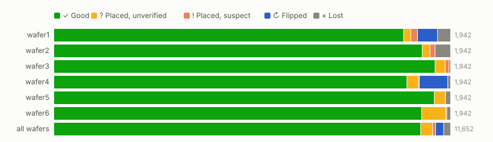
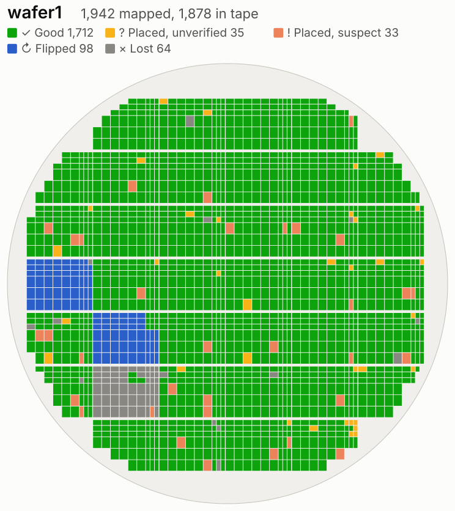
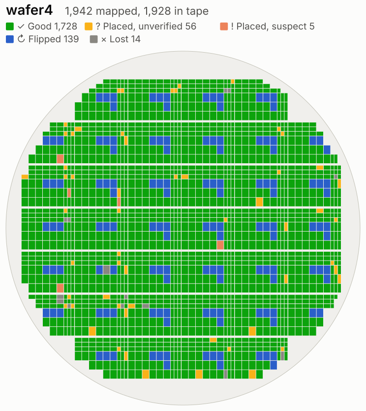

# wafer.space Run 2 pick map

Where every die of [wafer.space GF180MCU Run 2](https://github.com/wafer-space/ws-run2) (shuttle G802) ended up: which reel, which pocket, and how it looked when it got there.

**[Open the report: wafer.space/ws-run2-pickmap](https://wafer.space/ws-run2-pickmap/)**

Six wafers were sorted die by die into tape-and-reel, one reel per project code, between 2026-10-16 and 2026-10-25. The machine logged every pick and photographed every die in its pocket. This repo is the result of those logs: an interactive report, a printable page per reel, and the raw tables.

## Find your dies

1. Open the [Projects table](https://wafer.space/ws-run2-pickmap/#projects) and click your project code.
2. That opens your reel's page, for example [EURO](https://wafer.space/ws-run2-pickmap/print/EURO.html). It lists what is on the reel wafer by wafer, flags every die that needs a second look, and lists every pocket. It is laid out to print and keep next to the reel.

Some projects have two codes and so two reels (`MEME_1` and `MEME_2`, for example). A few dies are not on their project's reel at all, because they went onto a reticle reel (see below). The tally at the top of each reel page says when that happened.

## The numbers

| | Dies | Share of mapped |
|---|---:|---:|
| Mapped on the wafers | 11,652 | |
| **In tape** | **11,449** | **98.3%** |
| Good | 10,771 | 92.4% |
| Placed, unverified | 350 | 3.0% |
| Placed, suspect | 89 | 0.8% |
| Flipped | 239 | 2.1% |
| Lost | 203 | 1.7% |

The median die took 16 seconds, over about 63 hours of placing.

## What stands out

**Nearly all the flipped dies are in a few long runs, so they are easy to deal with.** 237 of the 239 come from two wafers, and each group sits unbroken on its reel:

| Wafer | Reel | Flipped | Where, by die # off the reel | How we know |
|---|---|---:|---|---|
| wafer4 | APTX | 38 | 77-114 | Pocket photos |
| wafer4 | COLF | 37 | 77-113 | Pocket photos |
| wafer4 | NEXA | 36 | 73-108 | Pocket photos |
| wafer4 | WSLG | 28 | 75-102 | Pocket photos |
| wafer1 | reticle S-3_-1 | 53 | 1-53 | Nozzle angles only |
| wafer1 | reticle S-2_-2 | 45 | 10-54 | Nozzle angles only |
| wafer2 | AS04 | 1 | 175 | Nozzle angles only |
| wafer2 | SCC0 | 1 | 157 | Nozzle angles only |

"Flipped" here means rotated in the pocket, not face down: 200 of these are 180° off and 39 are 90° off. Flips are the biggest single reason wafer1 and wafer4 have the lowest Good % in the table below.

<table>
  <tr>
    <td width="50%"></td>
    <td width="50%"></td>
  </tr>
</table>

**Unverified does not mean bad.** Those 350 dies are in tape, but the automatic pocket check failed on 321 and did not run on 29, and nobody has looked at them since. Wafer6 has the most, at 118.

**More than half the lost dies never reached the tape.** 92 of the 203 were not on the nozzle when the up-looking camera checked for them, and 27 were gone from the wafer before they could be picked. Another 59 landed on the pocket wall or left the pocket empty.

| Wafer | Mapped | In tape | Good | Unverified | Suspect | Flipped | Lost | Good % |
|---|---:|---:|---:|---:|---:|---:|---:|---:|
| wafer1 | 1,942 | 1,878 | 1,712 | 35 | 33 | 98 | 64 | 88.2% |
| wafer2 | 1,942 | 1,868 | 1,803 | 38 | 25 | 2 | 74 | 92.8% |
| wafer3 | 1,942 | 1,934 | 1,866 | 49 | 19 | 0 | 8 | 96.1% |
| wafer4 | 1,942 | 1,928 | 1,728 | 56 | 5 | 139 | 14 | 89.0% |
| wafer5 | 1,942 | 1,918 | 1,862 | 54 | 2 | 0 | 24 | 95.9% |
| wafer6 | 1,942 | 1,923 | 1,800 | 118 | 5 | 0 | 19 | 92.7% |

## Reading a reel

**Numbers count from the end of the reel.** A reel comes off last in, first out, so die #1 is the last die placed. Reels start with wafer6 and end with wafer1, except `DCO0` and `NSCN`, where one wafer's run went on out of turn. The report and reel pages all use this order. `dies.csv` also has the order the reel was filled, as `reel_seq` and `reel_pocket_est`.

**Trust the die number over the pocket number.** The order of dies on a reel is reliable. Pocket numbers are estimates: the machine left empty pockets between wafers, but only logged them from 2026-10-23. So on a reel that shows no gaps, there may still be empty pockets it does not know about. 25 of the 59 reels have logged gaps. If a pocket number disagrees with the tape, go by the sequence of dies.

**Reticle reels are the exception.** 110 early wafer1 dies went onto five reels that hold a reticle's dies rather than one project's (`reticle S-3_-1`, for example). These have mixed projects on them, and 98 of the 110 are flipped. In `dies.csv`, filter `reel` for names starting with `reticle`, or search by your `project_code`.

## Statuses

Each die has one status, and the worst one that applies wins.

| Status | Meaning |
|---|---|
| `GOOD` | In its pocket, face up, the right way round. The pocket check passed it, or a person looked and vouched for it. |
| `PLACED_UNVERIFIED` | In tape, but the check did not pass it or did not run, and nobody has looked since. |
| `PLACED_SUSPECT` | In tape, but a person reviewing its photo said it was not seated, the pocket looked empty, or it was unclear. |
| `FLIPPED` | In tape, turned 180° or 90° from the reel's orientation. |
| `LOST` | Not in tape: missed or dropped on the way, taken back out, or gone from the wafer before it could be picked. |

## Private projects

Eleven projects on this run are private, and this repo treats them the way the [Run 2 project list](https://github.com/wafer-space/ws-run2) does: their codes appear, their names do not. Their dies are counted like any others, but their pocket photos are left out because a photo would show the die's layout.

## What's in this repo

| Path | What it is |
|---|---|
| [`index.html`](https://wafer.space/ws-run2-pickmap/) | The report |
| [`print/`](print/) | A printable page per project reel |
| [`data/dies.csv`](data/dies.csv) | The master table, one row per die |
| [`data/`](data/) | Reels, reel segments, flipped dies, exceptions, projects, wafers. [`schema.csv`](data/schema.csv) explains every column. The `.js` files are the same tables for the report's data viewer. |
| [`run2.xlsx`](run2.xlsx) | Every table as a sheet |
| [`svg/`](svg/) | Every chart as its own SVG |
| [`photos/projects/`](photos/projects/) | One pocket photo per public project, and the machine's check of it |

The site is served from the root of `main` by GitHub Pages. Everything except this README and the license is generated from the machine's run logs, and is overwritten each time the report is rebuilt. The figures above are as of 2026-11-03.
